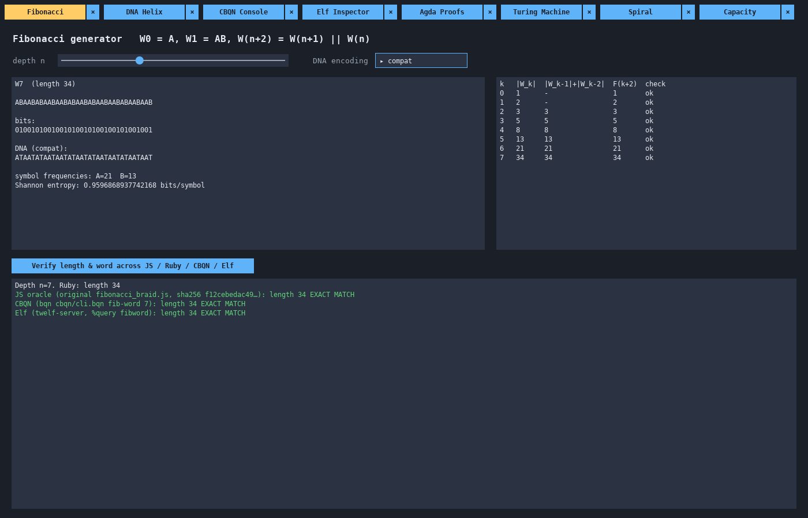
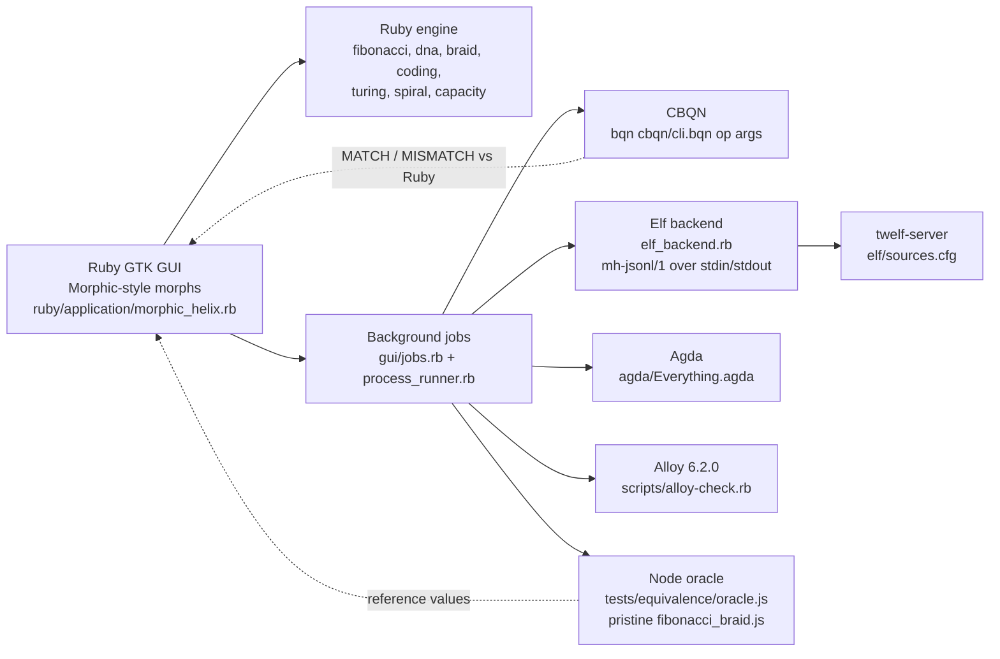
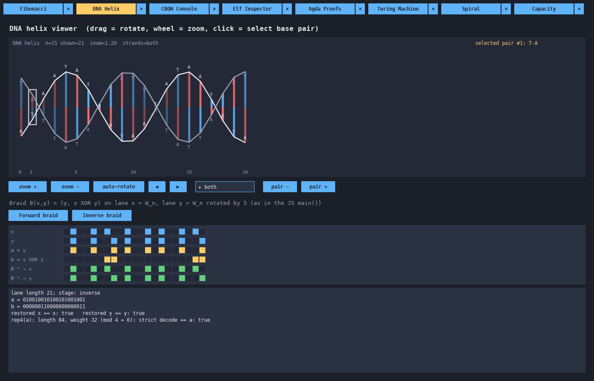
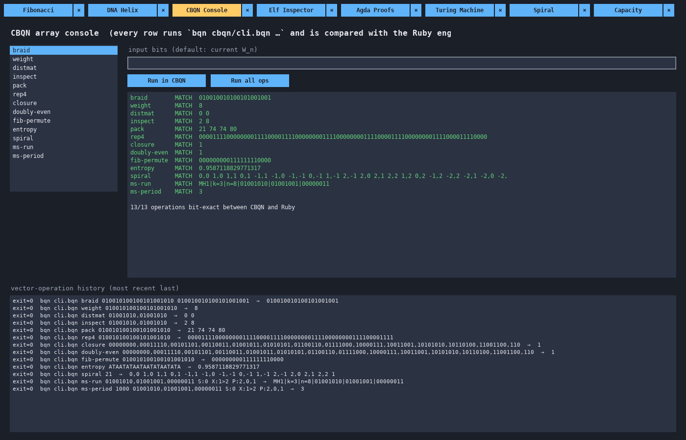
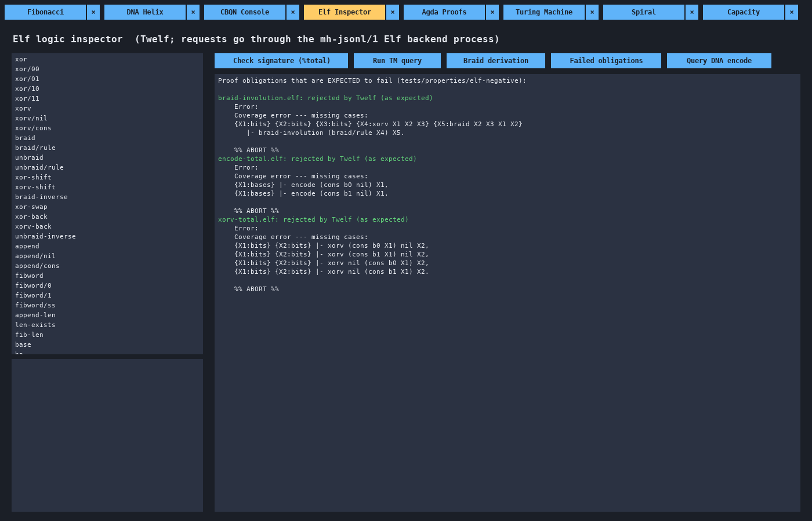
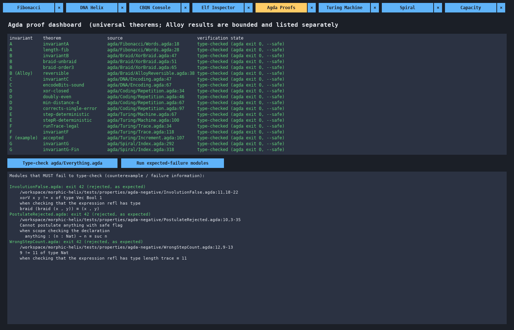
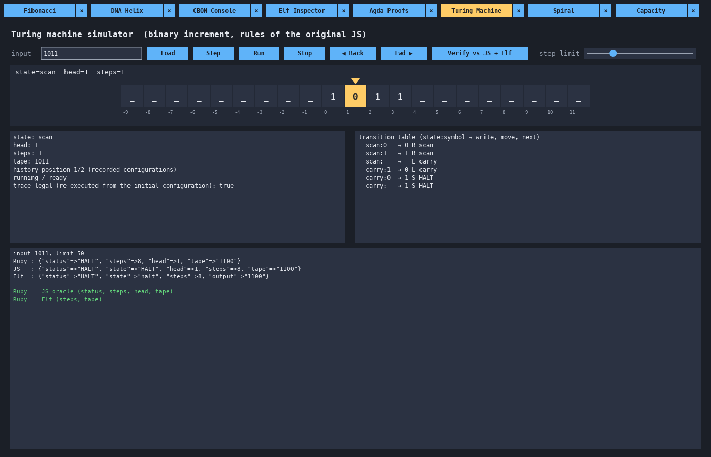
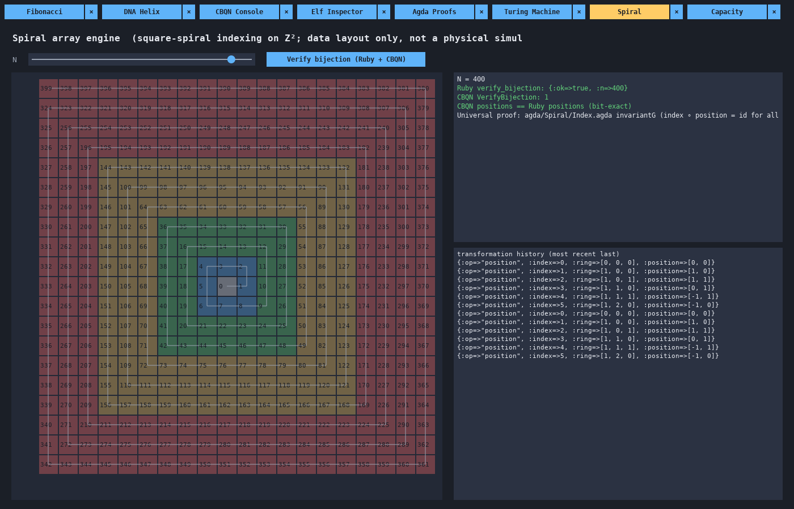
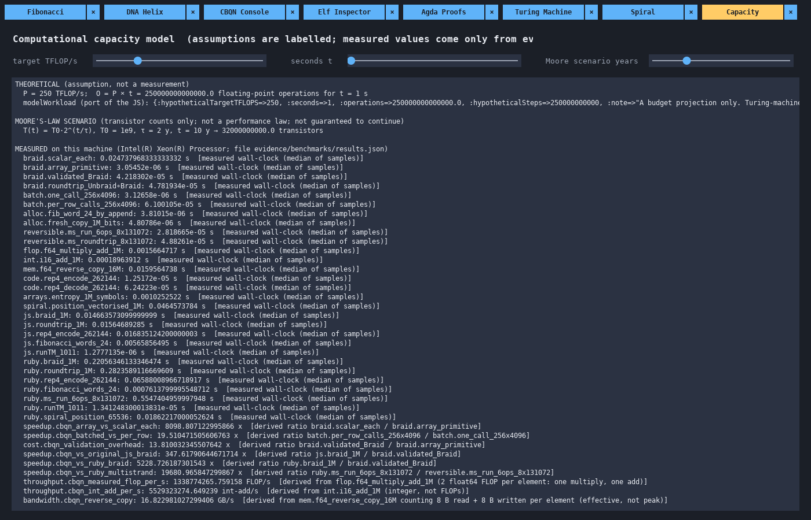

# Morphic Helix

**A Fibonacci braid engine, carried across five languages and checked by two proof tools.**

Morphic Helix takes a small, sharp JavaScript program — a Fibonacci-word generator, a DNA-style encoder, a reversible two-lane XOR braid, a fourfold repetition code, and a finite Turing machine — and rebuilds it as a working system you can see, run, and reason about. Ruby drives a desktop GUI and orchestrates everything; CBQN runs the array kernels; Twelf (the Elf logic framework) answers queries as derivations; Agda proves the invariants for every input size; and Alloy 6 searches for counterexamples inside bounded scopes.

The original JavaScript is the anchor for all of it. It sits untouched in [`source/original-archive/pristine/`](source/original-archive/pristine/fibonacci_braid/fibonacci_braid.js), and every port is compared against it, value for value.



---

## Contents

1. [Why this project exists](#why-this-project-exists)
2. [The ideas, one at a time](#the-ideas-one-at-a-time)
3. [How the pieces fit together](#how-the-pieces-fit-together)
4. [A tour of the GUI](#a-tour-of-the-gui)
5. [The components](#the-components)
6. [What is proved, and where](#what-is-proved-and-where)
7. [Setting it up](#setting-it-up)
8. [Running it](#running-it)
9. [Verification results](#verification-results)
10. [Benchmarks](#benchmarks)
11. [Scope of the claims](#scope-of-the-claims)
12. [Corrections to the original README](#corrections-to-the-original-readme)
13. [Project layout](#project-layout)
14. [What comes next](#what-comes-next)
15. [License](#license)

---

## Why this project exists

The original program is about a hundred lines of JavaScript. It builds a 21-bit Fibonacci word, braids it against a rotated copy of itself, encodes the result with a repetition code, runs a binary-increment Turing machine, and prints a JSON report. Every step is guarded by `assert`, so if the program finishes, the example worked.

That is a good start, but an assertion on one example is a test, not a guarantee. The interesting questions sit just past it. Is the braid reversible for *every* pair of lanes, of *every* length? Does the repetition code stay closed under XOR at any size? Is the spiral indexing really a bijection, or does it only look like one on the first few rings? And what does the braid look like, rather than what does it print?

Morphic Helix is the answer to those questions, built in layers:

- **See it.** A GTK desktop app with eight panels lets you drag a DNA helix around, step a Turing machine forwards and backwards, and watch a square spiral fill the plane.
- **Run it fast.** The array kernels are written in CBQN, where a braid of a million bits is one vectorised XOR.
- **Ask it as logic.** The Twelf backend treats each operation as a proposition. Its answer is a derivation, found by proof search.
- **Prove it.** The Agda modules prove the invariants for all inputs, under `--safe`, with no postulates.
- **Hunt for counterexamples.** The Alloy specs search every model up to a stated size, and some of them are written to find counterexamples on purpose, to show what goes wrong when an assumption is removed.

Through all of it, the original JavaScript stays the reference. The test oracle loads the pristine file inside a Node `vm` context, so the ports are measured against the code exactly as it was written, not against a reinterpretation of it.

---

## The ideas, one at a time

### Fibonacci words

A Fibonacci word is what you get when you apply the Fibonacci recurrence to strings instead of numbers. Start with two seeds and concatenate:

$$
W_0 = \mathtt{A}, \qquad W_1 = \mathtt{AB}, \qquad W_{n+2} = W_{n+1} \,\Vert\, W_n
$$

Each word begins with the previous one, so the sequence converges to one infinite word, and the lengths follow the Fibonacci numbers: $|W_n| = F(n+2)$, with $F(0)=0$ and $F(1)=1$. The engine stores $\mathtt{A}=0$ and $\mathtt{B}=1$, exactly as the JavaScript does.

Here are the first seven words, which is precisely what `fibonacciWords(7)` returns:

| $n$ | $W_n$ | bits | $\lvert W_n \rvert$ |
|---|---|---|---|
| 0 | `A` | `0` | 1 |
| 1 | `AB` | `01` | 2 |
| 2 | `ABA` | `010` | 3 |
| 3 | `ABAAB` | `01001` | 5 |
| 4 | `ABAABABA` | `01001010` | 8 |
| 5 | `ABAABABAABAAB` | `0100101001001` | 13 |
| 6 | `ABAABABAABAABABAABABA` | `010010100100101001010` | 21 |

$W_6$ is the 21-bit word the original `main()` braids. The Ruby port can also read a single symbol of a huge word without building it, by walking down the recurrence: position $i$ of $W_n$ is in the $W_{n-1}$ prefix if $i < |W_{n-1}|$, and otherwise it is position $i - |W_{n-1}|$ of $W_{n-2}$.

### From bits to bases

The original maps each symbol to a nucleotide letter, `0 → A` and `1 → T`. That is the **compatibility mode**, and every port reproduces it, so $W_6$ becomes `ATAATATAATAATATAATATA`.

Using only two of the four letters wastes half the alphabet, so Morphic Helix adds a **two-bit mode**. Each pair of bits becomes one base, with the first bit as the high bit:

| bits | base | complement |
|---|---|---|
| `00` | A | T |
| `01` | C | G |
| `10` | G | C |
| `11` | T | A |

This is a bijection $\{0,1\}^2 \to \{\mathtt{A},\mathtt{C},\mathtt{G},\mathtt{T}\}$, so decoding is exact. For example, `10110010` encodes to `GTAG`, whose complement strand is `CATC`. Odd-length input has no exact encoding. By default it is rejected, and with the `:pad_zero` policy one zero bit is appended and the padding is recorded, so it can be stripped again on decode.

The Alloy spec `dna_encoding.als` confirms both directions of the two-bit round trip and confirms that the compatibility map is injective. It also confirms, by producing a counterexample, that the compatibility map is *not* onto: C and G are never produced. That is expected, and it is the reason the two-bit mode exists.

### The braid

The heart of the engine is a reversible map on two equal-length bit lanes:

$$
B(x, y) = (y,\; x \oplus y), \qquad B^{-1}(a, b) = (a \oplus b,\; a)
$$

To see that $B^{-1}$ undoes $B$, substitute: $B^{-1}(y, x \oplus y) = (y \oplus x \oplus y,\; y) = (x, y)$. No information is lost, so you can always run the braid backwards.

It is *not* its own inverse. Applying it repeatedly shows its order:

$$
(x, y) \xrightarrow{B} (y,\; x \oplus y) \xrightarrow{B} (x \oplus y,\; x) \xrightarrow{B} (x,\; y)
$$

So $B^3 = \mathrm{id}$, while $B^2 \ne \mathrm{id}$. Here is a worked example on two 4-bit lanes:

| step | lane 1 | lane 2 |
|---|---|---|
| start $(x, y)$ | `1100` | `1010` |
| $B$ | `1010` | `0110` |
| $B^2$ | `0110` | `1100` |
| $B^3$ | `1100` | `1010` |

The original `main()` braids $W_6$ against itself rotated left by five positions, $y_i = x_{(i+5) \bmod 21}$:

```
x = 010010100100101001010      (W6)
y = 010010010100101001001      (W6 rotated by 5)
a = 010010010100101001001      (a = y)
b = 000000110000000000011      (b = x XOR y)
```

Unbraiding $(a, b)$ returns exactly $x$ and $y$. That is the picture in the DNA Helix panel's lane grid below.

The name "braid" is a description, not a claim about group theory. These maps are not generators of the Artin braid group. The multistrand extension applies the same $\sigma$ to adjacent strands of a $k$-strand state, and a test (`test_sigma_violates_braid_relation`) shows that $\sigma_0\sigma_1\sigma_0 \ne \sigma_1\sigma_0\sigma_1$ on the state $(0,0,1)$.

### The fourfold repetition code

After braiding, the original encodes lane $a$ with the simplest possible code: each bit is written four times.

$$
0 \mapsto 0000, \qquad 1 \mapsto 1111
$$

For messages of $k$ bits, the code is the set $C = \{\mathrm{rep}_4(u) : u \in \{0,1\}^k\}$. It has three properties worth knowing:

- **XOR-closed (linear).** $\mathrm{rep}_4(u) \oplus \mathrm{rep}_4(v) = \mathrm{rep}_4(u \oplus v)$, so the XOR of two codewords is a codeword.
- **Doubly even.** Every codeword has weight $4 \cdot \mathrm{wt}(u)$, which is divisible by 4.
- **Minimum distance 4.** Two different messages differ in at least one bit, and each differing bit costs four positions.

Minimum distance 4 means the code **corrects any single-bit error** in a block, because $\lfloor (4-1)/2 \rfloor = 1$, and it **detects any two errors**. A block like `1101` is three-quarters ones, so it corrects to `1`. A block like `1100` is equidistant from both codewords, so it is reported as an error rather than guessed. In the original example, $\mathrm{rep}_4(a)$ is 84 bits long with weight 32.

The engine keeps the original's strict decoder (`decode_rep4`, which rejects any corrupted block, just like `decodeDoublyEven`) and adds a separate correcting decoder, `correct_rep4`. It also includes the classical extended Hamming [8,4,4] code as a second doubly even example, and it shows by counterexample that windows cut from a Fibonacci word do not form an XOR-closed code.

### The Turing machine

The original ships a small, general Turing-machine runner: a sparse tape, a rule table keyed by `state:symbol`, moves `L`, `R`, and `S`, and a step budget. Its example machine increments a binary number. It scans right to the blank after the last digit, then turns around and carries:

| rule | write | move | next |
|---|---|---|---|
| `scan:0` | 0 | R | scan |
| `scan:1` | 1 | R | scan |
| `scan:_` | _ | L | carry |
| `carry:1` | 0 | L | carry |
| `carry:0` | 1 | S | HALT |
| `carry:_` | 1 | S | HALT |

Feeding it `1011` (eleven) produces `1100` (twelve) in eight steps. This is the actual trace from the Ruby port:

| step | state | head | read | write | move | next | tape after |
|---|---|---|---|---|---|---|---|
| 1 | scan | 0 | 1 | 1 | R | scan | `1011` |
| 2 | scan | 1 | 0 | 0 | R | scan | `1011` |
| 3 | scan | 2 | 1 | 1 | R | scan | `1011` |
| 4 | scan | 3 | 1 | 1 | R | scan | `1011` |
| 5 | scan | 4 | _ | _ | L | carry | `1011` |
| 6 | carry | 3 | 1 | 0 | L | carry | `1010` |
| 7 | carry | 2 | 1 | 0 | L | carry | `1000` |
| 8 | carry | 1 | 0 | 1 | S | HALT | `1100` |

Nine configurations, eight transitions, and the head finishes on cell 1. The Ruby port records every configuration and the cell each transition overwrote, so the GUI can step *backwards* through a run, and `legal_trace?` can re-execute a recorded trace from the start and reject a forged one.

### The square spiral

The spiral is an extension. It gives every natural number a home on the integer lattice $\mathbb{Z}^2$ by winding outwards from the origin, the way an Ulam spiral does. Index 0 sits at $(0,0)$. Ring $r \ge 1$ holds the $8r$ indices from $(2r-1)^2$ to $(2r+1)^2 - 1$, split into four sides of $2r$ cells. For offset $t \in [0, 2r)$ on side $s$:

$$
\begin{aligned}
s=0 &: (r,\; -r+1+t) &\qquad s=1 &: (r-1-t,\; r) \\
s=2 &: (-r,\; r-1-t) &\qquad s=3 &: (-r+1+t,\; -r)
\end{aligned}
$$

The first few positions are $0 \mapsto (0,0)$, $1 \mapsto (1,0)$, $2 \mapsto (1,1)$, $3 \mapsto (0,1)$, $4 \mapsto (-1,1)$, $5 \mapsto (-1,0)$, $6 \mapsto (-1,-1)$, $7 \mapsto (0,-1)$, $8 \mapsto (1,-1)$, and ring 2 starts at $9 \mapsto (2,-1)$.

The inverse, `index(x, y)`, takes $r = \max(|x|, |y|)$, works out which side the point is on, and adds the offset. The two directions form a bijection $\mathbb{N} \leftrightarrow \mathbb{Z}^2$, and `index ∘ position = id` is proved in Agda for every $n$. For an odd side length $s = 2R+1$, the first $s^2$ positions fill the square $[-R, R]^2$ exactly, which makes the spiral a practical layout for 2-D and layered 3-D arrays. A Fibonacci grouping batches rings into groups of sizes 1, 2, 3, 5, 8, and so on. It is a scheduling parameter for walking the rings.

### The capacity model

The original ends with a back-of-the-envelope budget: at an assumed throughput $P$, running for $t$ seconds gives

$$
O = P \cdot t
$$

operations. With the defaults $P = 100$ TFLOP/s and $t = 1$ s, that is $10^{14}$ operations, or $10^{11}$ hypothetical steps at 1000 FLOP per step. The Ruby `model_workload` reproduces that output exactly.

The point of the model is a distinction: a floating-point operation, a bitwise XOR, and a Turing-machine step are different units of work. Morphic Helix keeps them apart everywhere. The benchmark file reports float64 multiply-adds in FLOP/s, XORs in bit-XOR/s, integer adds in int-add/s, and copies in GB/s, each measured separately. The Capacity panel also has a transistor-count scenario, $T(t) = T_0 \cdot 2^{t/\tau}$ with $\tau = 2$ years, shown as a scenario you can tune, next to the numbers that were actually measured.

---

## How the pieces fit together



In words: the Ruby GUI holds the Ruby engine in-process and uses it for everything interactive. When a button needs an outside tool, the GUI starts a background job that launches the tool as a child process: `bqn` for array operations, the Elf backend for logic queries, `agda` for type-checking, Java for Alloy, and `node` for the reference oracle. The Elf backend is its own process. It reads one JSON request per line, runs `twelf-server` on the signature plus a generated query, and writes one JSON response per line. Every result that comes back is compared with the Ruby engine and shown as a match or a mismatch. The test suites follow the same paths as the GUI.

The Elf protocol, `mh-jsonl/1`, is small. A request carries `protocol`, `id`, `op`, `input`, and `limits` (`timeout_s`, `max_steps`). A response carries `id`, `op`, `ok`, `result`, an `error` with a `type` and `message`, and `evidence` (the argv, exit status, duration, and a SHA-256 of the Twelf transcript). The supported operations are `check_signature`, `fib_word`, `braid`, `unbraid`, `dna_encode`, `dna_decode`, `tm_increment`, `braid_inverse_derivation`, and `check_file`.

---

## A tour of the GUI

The GUI is a set of eight tabs. Each tab is a tree of morphs, small objects that know their bounds, draw themselves with Cairo, and receive mouse and keyboard events through a `WorldMorph`. This is a Morphic-style object model written for this project and hosted in GTK 3. Every button that calls a backend really calls it; if a tool is missing, the panel says `FAILED: missing <tool>`.

| Panel | What you do there | Backends it calls |
|---|---|---|
| Fibonacci | Pick a depth, read the word, its bits, DNA, and entropy; verify across languages | Ruby, Node, CBQN, Twelf |
| DNA Helix | Rotate and zoom the helix, select base pairs, braid and unbraid the lanes | Ruby |
| CBQN Console | Run array operations in CBQN and compare each with Ruby | CBQN |
| Elf Inspector | Browse the Twelf signature, run queries, see rejected obligations | Twelf via the Elf backend |
| Agda Proofs | See the theorem table, type-check everything, run the must-fail modules | Agda |
| Turing Machine | Load, step, run, and rewind the increment machine | Ruby, Node, Twelf |
| Spiral | Fill a spiral of N cells and verify the bijection | Ruby, CBQN |
| Capacity | Tune the budget and the transistor scenario next to measured numbers | Ruby, benchmark file |

### Fibonacci


The first panel is the generator. The slider sets the depth $n$, and the left pane shows $W_n$ as letters, as bits, and as DNA in the chosen encoding, with the symbol counts and Shannon entropy. In the screenshot $n = 7$, so $W_7$ is 34 symbols long, with 21 A's and 13 B's. The right pane checks the length recurrence row by row: $|W_k|$, $|W_{k-1}| + |W_{k-2}|$, and $F(k+2)$, each marked `ok`. The verify button sends the same request to the original JavaScript (identified by its SHA-256), to CBQN, and to Twelf, and every line comes back `EXACT MATCH`.

### DNA Helix



The helix viewer draws the word as a double strand: each base on one backbone and its complement on the other. Drag to rotate, scroll to zoom, and click a rung to select a base pair; the screenshot shows pair #1, T–A, highlighted. Below the helix is the braid itself, applied to the lanes of the original `main()`: $x = W_n$ and $y = W_n$ rotated by 5. The grid shows $x$, $y$, $a = y$, $b = x \oplus y$, and the two lanes recovered by $B^{-1}$. The text pane confirms the round trip and the code: `rep4(a)` has length 84 and weight 32, which is divisible by 4, and strict decoding returns $a$.

### CBQN Console



The console is where the array kernels run. Pick an operation, or press **Run all ops**, and each one is executed as `bqn cbqn/cli.bqn <op> <args>` and compared with the Ruby engine. In the screenshot all 13 operations come back `MATCH`: braid, weight, distance matrix, inspect, pack, rep4, closure, doubly-even, Fibonacci permutation, entropy, spiral, and the multistrand run and period. The bottom pane is the exact command history, with each command's exit code, so you can paste any line into a terminal and reproduce it.

### Elf Inspector



The inspector lists every constant in the Twelf signature on the left: the bit and vector relations, the braid and unbraid rules, the Fibonacci word judgment, and the metatheorems such as `braid-inverse` and `fib-len`. The buttons check the whole signature, run a Turing-machine query, return the derivation that inverts a braid, and run a DNA encoding query. The screenshot shows the **Failed obligations** view: three claims that are false by design, each rejected by Twelf's coverage checker with the exact missing cases. "Braid is an involution" fails, `encode` is not total on odd-length input, and `xorv` is not total on lanes of unequal length.

### Agda Proofs



The proof dashboard lists every theorem behind invariants A to G, with its file and line, and the state of the last type-check. **Type-check agda/Everything.agda** runs the real checker in the background, and the window stays responsive while it works. **Run expected-failure modules** runs three modules that must be rejected: one claims the increment run takes 11 steps (it takes 9 configurations, so `9 != 11`), one tries to `postulate` under `--safe`, and one claims the braid is an involution. All three are rejected with exit 42, and the panel shows Agda's own error text.

### Turing Machine



The simulator draws the tape as a row of cells, with the head marked. **Load** places the input, **Step** and **Run** move forwards, and **◀ Back** and **Fwd ▶** move through the recorded history, so you can rewind a run one transition at a time. The screenshot was taken after the first step, with the head on cell 1 and the full transition table beside it. The bottom pane shows a completed verification of `1011`: Ruby, the original JavaScript, and Twelf all report `HALT` after 8 steps with tape `1100`.

### Spiral



The spiral panel lays out indices 0 to N−1 on the lattice and colours the rings by their Fibonacci group, so you can watch the plane fill outwards from the centre. The slider runs from 1 to 441 cells, a full 21 × 21 square; this screenshot was taken at N = 400. **Verify bijection** checks the mapping in Ruby and in CBQN, confirms that the two produce identical positions, and points to the Agda proof that covers every $n$. The history pane records each `position` and `index` call with its ring coordinates.

### Capacity



The capacity panel puts the three kinds of number side by side. At the top is the budget model, $O = P \cdot t$, driven by the sliders, together with the output of the original `modelWorkload`. Next is the transistor-count scenario. Below them, read straight from `evidence/benchmarks/results.json`, is every measured timing and derived ratio from this machine, each labelled as measured or derived.

### Gallery

| | |
|---|---|
|  **Fibonacci** — word, DNA, entropy, cross-language check |  **DNA Helix** — double strand, braid lanes, round trip |
|  **CBQN Console** — 13/13 operations bit-exact with Ruby |  **Elf Inspector** — signature and rejected obligations |
|  **Agda Proofs** — theorem table and must-fail modules |  **Turing Machine** — tape, rules, reversible history |
|  **Spiral** — ring layout and bijection check |  **Capacity** — budget, scenario, measured numbers |

### Controls

The GUI runs every tool in the background, one job per panel, so it never freezes. If you click a button while that panel's job is still running, the panel shows `BUSY` instead of starting a second one.

| Action | Effect |
|---|---|
| Window close button | Quit |
| **Ctrl+Q** | Quit |
| **Escape** | Quit (when no text field has focus; inside a text field it releases focus) |
| **Ctrl+W** or the **×** on a tab | Close that panel and cancel its job; closing the last panel closes the window |
| SIGTERM, SIGINT, SIGHUP | Quit |

All the quit paths share one shutdown routine. It cancels every job and stops every child process group: TERM first, then KILL after 2 seconds. Closing takes about a tenth of a second even while Agda is type-checking, and no `agda`, `twelf-server`, `bqn`, or `node` process is left behind.

---

## The components

| Component | Language | Role | Entry point |
|---|---|---|---|
| Engine and GUI | Ruby 3.3 + ruby-gtk3 | Ports, extensions, orchestration, interface | [`ruby/application/morphic_helix.rb`](ruby/application/morphic_helix.rb) |
| Array kernels | CBQN | Vectorised braid, coding, spiral, entropy | [`cbqn/cli.bqn`](cbqn/cli.bqn) |
| Logic backend | Twelf (Elf) | Operations as derivations, `%total` metatheorems | [`elf/sources.cfg`](elf/sources.cfg) |
| Proofs | Agda 2.6.4.3 | Invariants A–G for all inputs | [`agda/Everything.agda`](agda/Everything.agda) |
| Model checking | Alloy 6.2.0 | Bounded searches for counterexamples | [`alloy/specifications/`](alloy/specifications/) |
| Reference oracle | Node.js | The pristine original, answering JSON requests | [`tests/equivalence/oracle.js`](tests/equivalence/oracle.js) |

### Ruby: the engine and the GUI

The Ruby side does two jobs. In [`ruby/application/`](ruby/application/) it holds a faithful port of every original function — [`fibonacci.rb`](ruby/application/fibonacci.rb), the compatibility half of [`dna.rb`](ruby/application/dna.rb), [`braid.rb`](ruby/application/braid.rb), the repetition code in [`coding.rb`](ruby/application/coding.rb), [`turing.rb`](ruby/application/turing.rb), and `model_workload` in [`capacity.rb`](ruby/application/capacity.rb). It keeps the same bounds and the same error behaviour; for example, `words(count)` accepts exactly the 2 to 24 that the JavaScript accepts. Next to the ports are the extensions: the two-bit DNA code, [`multistrand.rb`](ruby/application/multistrand.rb) for $k$-strand programs of permutations, XOR-mixes, and $\sigma$ moves, [`spiral.rb`](ruby/application/spiral.rb), [`arrays.rb`](ruby/application/arrays.rb), and [`physics_bounds.rb`](ruby/application/physics_bounds.rb) with the textbook limits (Landauer, Bekenstein, Margolus–Levitin, Bremermann).

Its other job is orchestration. [`ruby/morphic/`](ruby/morphic/) is the object model behind the panels, [`ruby/application/gui/`](ruby/application/gui/) holds the panels and the background-job runner, and [`ruby/adapters/`](ruby/adapters/) wraps each outside tool. [`process_runner.rb`](ruby/adapters/process_runner.rb) applies timeouts and tracks every child process group, so any run can be stopped cleanly.

### CBQN: the array kernels

BQN is an array language, and the braid is a natural fit for it: $B(x,y) = (y, x \neq y)$ over whole boolean arrays at once. The kernels in [`cbqn/braid/`](cbqn/braid/braid.bqn), [`cbqn/dna/`](cbqn/dna/dna.bqn), [`cbqn/fibonacci/`](cbqn/fibonacci/fibonacci.bqn), [`cbqn/arrays/`](cbqn/arrays/arrays.bqn), and [`cbqn/spiral/`](cbqn/spiral/spiral.bqn) cover the same ground as the Ruby engine, including batched braids over whole matrices, the extended Hamming code, and the multistrand runs. [`cbqn/cli.bqn`](cbqn/cli.bqn) exposes them as operations such as `fib-words`, `braid`, `rep4-correct`, `closure`, `spiral-verify`, and `ms-run`. Try one:

```sh
cd cbqn && bqn cli.bqn fib-words 7
```

### Twelf: logic as computation

In Twelf, a type such as `braid X Y A B` is a proposition, and a term of that type is a proof of it. When the backend asks for a braid, Twelf searches for such a proof, and the search *is* the computation. The answer it returns is read off the proof. The signatures in [`elf/`](elf/) cover symbols and bit vectors, the Fibonacci recurrence, DNA encoding, the braid and its inverse, and Turing-machine configurations, steps, and reachability.

Twelf also checks metatheorems with `%total`. `braid-inverse` says that every braid derivation can be turned into an unbraid derivation back to the inputs; `encode-decode`, `fib-len`, and `step-det` are checked the same way. The Turing machine uses an explicit fuel bound, and if no derivation exists within the fuel, the answer is `no_derivation`.

### Agda: the universal proofs

The modules in [`agda/`](agda/) prove the invariants for every input size. Each one starts with `--safe --without-K` and uses only `Agda.Builtin.*`, so there are no library assumptions and `postulate` is a type error. [`Braid/AlloyReversible.agda`](agda/Braid/AlloyReversible.agda) is a direct translation of the original Alloy model: the `Braid` signature and its `BraidTransition` fact become a record over `Fin n → Bit`, and `Reversible` is proved for every $n$, with the $n = 8$ Alloy case as one instance.

### Alloy: bounded model checking

Alloy explores every model up to a chosen size and either finds a counterexample or reports that none exists in that scope. The original [`braid_invariant.als`](alloy/specifications/braid_invariant.als) is run exactly as written, and three more specs cover the braid's inverses and order, the DNA encoding, and Turing-machine determinism. [`scripts/alloy-check.rb`](scripts/alloy-check.rb) runs them all and fails unless every command matches its expected outcome.

### The Node oracle

[`tests/equivalence/oracle.js`](tests/equivalence/oracle.js) loads the pristine `fibonacci_braid.js` inside a `vm` context. That gives it access to the internal helpers (`DNA`, `incrementRules`, `getTape`, `xor`) without editing a byte of the original. It answers JSON requests, and every port is compared against it.

---

## What is proved, and where

| Invariant | Statement | Agda theorems | File |
|---|---|---|---|
| A | $\lvert W_{n+2}\rvert = \lvert W_{n+1}\rvert + \lvert W_n\rvert$, and $\lvert W_n\rvert = F(n+2)$ | `invariantA`, `length-fib` | [`Fibonacci/Words.agda`](agda/Fibonacci/Words.agda) |
| B | $B^{-1}(B(x,y)) = (x,y)$, $B(B^{-1}(a,b)) = (a,b)$, $B^3 = \mathrm{id}$, $B^2 \ne \mathrm{id}$ | `invariantB`, `braid-unbraid`, `braid-order3`, `not-involution` | [`Braid/XorBraid.agda`](agda/Braid/XorBraid.agda) |
| B (Alloy model) | The original `Reversible` assertion, for every number of positions | `reversible`, `check-exactly-8`, `model-exists` | [`Braid/AlloyReversible.agda`](agda/Braid/AlloyReversible.agda) |
| C | Two-bit decode ∘ encode = id; exactly the even-length inputs encode; compat round trip | `invariantC`, `encodeBits-sound`, `encodeBits-complete`, `compat-roundtrip` | [`DNA/Encoding.agda`](agda/DNA/Encoding.agda) |
| D | Repetition code is XOR-closed, doubly even, distance 4, corrects 1 error, detects 2; Fibonacci windows are not closed | `xor-closed`, `doubly-even`, `min-distance-4`, `corrects-single-error`, `detects-double-error`, `windows-not-closed` | [`Coding/Repetition.agda`](agda/Coding/Repetition.agda) |
| E | A functional rule table gives a deterministic step | `step-deterministic`, `stepR-deterministic` | [`Turing/Machine.agda`](agda/Turing/Machine.agda) |
| F | An accepted trace is a chain of legal transitions; the 1011 → 1100 run is accepted | `invariantF`, `runTrace-legal`, `accepted` | [`Turing/Trace.agda`](agda/Turing/Trace.agda), [`Turing/Increment.agda`](agda/Turing/Increment.agda) |
| G | `index ∘ position = id`, `position` is injective, and the `Fin N` version | `invariantG`, `position-injective`, `invariantG-Fin` | [`Spiral/Index.agda`](agda/Spiral/Index.agda) |

[`Spiral/Vectors.agda`](agda/Spiral/Vectors.agda) is generated from the Ruby engine and checks that Agda's spiral agrees with Ruby's on 81 positions.

### Alloy commands

| Spec | Command | Scope | Outcome |
|---|---|---|---|
| `braid_invariant.als` (original) | `check Reversible` | exactly 8 Pos | no counterexample |
| `braid_invariant.als` (original) | `run {}` | exactly 8 Pos | instance found |
| `braid_extended.als` | `check LeftInverse` | exactly 8 Pos | no counterexample |
| `braid_extended.als` | `check RightInverse` | exactly 8 Pos | no counterexample |
| `braid_extended.als` | `check InvolutionClaim` | exactly 1 Pos | counterexample (as designed) |
| `braid_extended.als` | `check OrderThree` | exactly 4 Pos, 1..12 steps | no counterexample |
| `braid_extended.als` | `check OrderNotOne` | exactly 1 Pos, 1..4 steps | counterexample (as designed) |
| `dna_encoding.als` | `check DecodeEncode` | default | no counterexample |
| `dna_encoding.als` | `check EncodeDecode` | default | no counterexample |
| `dna_encoding.als` | `check Injective` | default | no counterexample |
| `dna_encoding.als` | `check CompatInjective` | default | no counterexample |
| `dna_encoding.als` | `check CompatOnto` | default | counterexample (as designed) |
| `turing_determinism.als` | `check Deterministic` | 4 | no counterexample |
| `turing_determinism.als` | `check DeterministicWithoutFunctionality` | 4 | counterexample (as designed) |

The counterexamples Alloy found are saved as readable traces in [`evidence/traces/alloy/`](evidence/traces/alloy/), with every outcome in [`summary.json`](evidence/traces/alloy/summary.json).

---

## Setting it up

The recorded evidence was produced on Debian 13 "trixie".

```sh
sudo apt-get install ruby ruby-gtk3 agda-bin openjdk-21-jre-headless xvfb x11-apps imagemagick openbox xdotool wmctrl procps build-essential libgmp-dev git nodejs
# CBQN (array language)
git clone https://github.com/dzaima/CBQN /opt/toolchains/CBQN && make -C /opt/toolchains/CBQN -j8 o3
sudo ln -s /opt/toolchains/CBQN/BQN /usr/local/bin/bqn
# Twelf from source (the 1.7.1 Linux release binary is 32-bit and did not run on this x86-64 machine)
#   MLton: https://github.com/MLton/mlton/releases/download/on-20241230-release/mlton-20241230-1.amd64-linux.ubuntu-24.04_glibc2.39.tgz
git clone https://github.com/standardml/twelf /opt/toolchains/twelf-src && make -C /opt/toolchains/twelf-src mlton
sudo ln -s /opt/toolchains/twelf-src/bin/twelf-server /usr/local/bin/twelf-server
# Alloy 6.2.0
curl -L -o /opt/toolchains/org.alloytools.alloy.dist.jar \
  https://github.com/AlloyTools/org.alloytools.alloy/releases/download/v6.2.0/org.alloytools.alloy.dist.jar
```

The exact commits, versions, and SHA-256 values used are in [`evidence/manifests/provenance.json`](evidence/manifests/provenance.json). You can point the tools elsewhere with `MH_BQN`, `MH_TWELF`, `MH_AGDA`, `MH_JAVA`, `MH_NODE`, and `MH_ALLOY_JAR`.

**Missing tools fail the build.** If a tool isn't there, nothing is skipped and nothing is substituted. The command stops with `missing <tool>` and a non-zero exit status, and the GUI panel that needed it says `FAILED: missing <tool>`. Two steps of the verification run check exactly this.

---

## Running it

| What | Command |
|---|---|
| GUI | `ruby ruby/application/morphic_helix.rb` (or `make gui`) |
| GUI, scripted | `ruby ruby/application/morphic_helix.rb --panel turing --actions click:btn-tm-load,click:btn-tm-run --dump-state s.json` |
| All verification | `sh scripts/verify-all.sh` (or `make verify`) |
| Tests only | `make test` |
| Benchmarks | `ruby scripts/run_benchmarks.rb 7` (or `make bench`) |
| GUI screenshots | `sh scripts/gui-screenshots.sh` (private Xvfb display) |
| GUI close test | `sh scripts/gui-close-test.sh` (Xvfb + openbox) |
| Agda | `cd agda && agda Everything.agda` |
| Alloy | `ruby scripts/alloy-check.rb [spec.als]` |
| Elf | `scripts/elf-check.sh [extra.elf]` |
| CBQN | `cd cbqn && bqn cli.bqn fib-words 7` |
| Original program | `node source/original-archive/pristine/fibonacci_braid/fibonacci_braid.js` |
| Manifests | `ruby scripts/build_manifests.rb` (or `make manifests`) |

The scripted GUI options are `--panel NAME`, `--actions LIST` (clicks and keys, run in order after start-up), `--dump-state FILE`, and `--quit-after MS`. The screenshot and close-test scripts use them to drive the real GUI.

---

## Verification results

`sh scripts/verify-all.sh` runs 25 steps. Eight of them are negative controls that must fail, with a specific error text, and they did. Exit codes are from [`evidence/verification/checks.tsv`](evidence/verification/checks.tsv); each step's full log is in [`evidence/verification/logs/`](evidence/verification/logs/).

| Step | What it checks | Exit |
|---|---|---|
| `tools` | Every required tool is installed | 0 |
| `versions` | Records tool versions | 0 |
| `policy` | AGPL headers, official LICENSE, no CI besides the Pages workflow, no tar, Agda `--safe` | 0 |
| `ruby-syntax` | Every Ruby file parses | 0 |
| `original-js-main` | The pristine original runs | 0 |
| `regression` | Golden original output and archive hashes | 0 |
| `vectors-deterministic` | Test vectors regenerate byte-identically | 0 |
| `agda-vectors-deterministic` | `Spiral/Vectors.agda` regenerates byte-identically | 0 |
| `properties` | Seeded and exhaustive Ruby properties | 0 |
| `equivalence` | JS ↔ Ruby ↔ CBQN ↔ Elf comparisons | 0 |
| `agda-everything` | All Agda modules type-check | 0 |
| `agda-negative-WrongStepCount` | Must fail: wrong step count | 42 |
| `agda-negative-PostulateRejected` | Must fail: postulate under `--safe` | 42 |
| `agda-negative-InvolutionFalse` | Must fail: braid as involution | 42 |
| `elf-signature` | Twelf signature and `%total` checks | 0 |
| `elf-negative-braid-involution` | Must fail: coverage error | 1 |
| `elf-negative-encode-total` | Must fail: coverage error | 1 |
| `elf-negative-xorv-total` | Must fail: coverage error | 1 |
| `alloy` | Every Alloy command meets its expectation | 0 |
| `integration` | Elf process boundary, Agda table, process cleanup | 0 |
| `missing-tool-fails-closed` | Must fail: `missing bqn` | 127 |
| `missing-tool-adapter` | Must fail: adapter raises `MissingTool` | 1 |
| `gui-screenshots` | All 8 panels render under Xvfb | 0 |
| `gui-close` | Every close path, including during an Agda run | 0 |
| `manifests` | Provenance, verification, and file hashes | 0 |

The test suites behind those steps:

| Suite | Runs | Assertions | Failures |
|---|---|---|---|
| [`tests/regression`](tests/regression/test_regression.rb) | 4 | 13 | 0 |
| [`tests/properties`](tests/properties/test_properties.rb) | 12 | 16,760 | 0 |
| [`tests/equivalence`](tests/equivalence/test_equivalence.rb) | 12 | 676 | 0 |
| [`tests/integration`](tests/integration/test_integration.rb) | 9 | 162 | 0 |

The equivalence suite made 676 cross-language comparisons with 0 mismatches ([`evidence/traces/equivalence.json`](evidence/traces/equivalence.json)).

---

## Benchmarks

Measured with `ruby scripts/run_benchmarks.rb 7`. Each value is the median of 7 samples, and each sample is the mean over an inner repetition count. Raw data: [`evidence/benchmarks/results.json`](evidence/benchmarks/results.json).

**Machine:** Intel(R) Xeon(R) Processor, 8 logical CPUs (KVM guest), 16386416 kB RAM, Linux 6.12.113+ x86_64, Debian GNU/Linux 13 (trixie). Ruby 3.3.13, Node v24.22.1, CBQN at commit `588753c8`. One unrelated `factor` process was using a full core during the run.

### Braiding a million bits

| Implementation | Benchmark | Elements | Median time | ns / element |
|---|---|---|---|---|
| CBQN, array primitive | `braid.array_primitive` | 1,048,576 | 3.055 µs | 0.002913 |
| CBQN, validated `Braid` | `braid.validated_Braid` | 1,048,576 | 42.18 µs | 0.04023 |
| CBQN, element by element | `braid.scalar_each` | 1,048,576 | 24.74 ms | 23.59 |
| Original JS | `js.braid_1M` | 1,048,576 | 14.66 ms | 13.98 |
| Ruby | `ruby.braid_1M` | 1,048,576 | 220.6 ms | 210.3 |

### All measurements

| Benchmark | Source | Elements | Median time | ns / element |
|---|---|---|---|---|
| `braid.roundtrip_Unbraid∘Braid` | cbqn | 1,048,576 | 47.82 µs | 0.0456 |
| `batch.one_call_256x4096` | cbqn | 1,048,576 | 3.127 µs | 0.002982 |
| `batch.per_row_calls_256x4096` | cbqn | 1,048,576 | 61 µs | 0.05818 |
| `alloc.fib_word_24_by_append` | cbqn | 121,393 | 3.81 µs | 0.03139 |
| `alloc.fresh_copy_1M_bits` | cbqn | 1,048,576 | 4.808 µs | 0.004585 |
| `reversible.ms_run_6ops_8x131072` | cbqn | 1,048,576 | 28.19 µs | 0.02688 |
| `reversible.ms_roundtrip_8x131072` | cbqn | 1,048,576 | 48.83 µs | 0.04656 |
| `flop.f64_multiply_add_1M` | cbqn | 1,048,576 | 1.566 ms | 1.494 |
| `int.i16_add_1M` | cbqn | 1,048,576 | 189.6 µs | 0.1809 |
| `mem.f64_reverse_copy_16M` | cbqn | 16,777,216 | 15.96 ms | 0.9511 |
| `code.rep4_encode_262144` | cbqn | 262,144 | 12.52 µs | 0.04775 |
| `code.rep4_decode_262144` | cbqn | 262,144 | 62.42 µs | 0.2381 |
| `arrays.entropy_1M_symbols` | cbqn | 1,048,576 | 1.025 ms | 0.9778 |
| `spiral.position_vectorised_1M` | cbqn | 1,048,576 | 46.46 ms | 44.31 |
| `js.roundtrip_1M` | node (original JS) | 1,048,576 | 15.65 ms | 14.92 |
| `js.rep4_encode_262144` | node (original JS) | 262,144 | 16.84 ms | 64.22 |
| `js.fibonacci_words_24` | node (original JS) | 121,393 | 5.659 ms | 46.61 |
| `js.runTM_1011` | node (original JS) | 8 | 1.278 µs | 159.7 |
| `ruby.roundtrip_1M` | ruby | 1,048,576 | 282.4 ms | 269.3 |
| `ruby.rep4_encode_262144` | ruby | 262,144 | 65.88 ms | 251.3 |
| `ruby.fibonacci_words_24` | ruby | 121,393 | 761.4 µs | 6.272 |
| `ruby.ms_run_6ops_8x131072` | ruby | 1,048,576 | 554.7 ms | 529 |
| `ruby.runTM_1011` | ruby | 8 | 13.41 µs | 1677 |
| `ruby.spiral_position_65536` | ruby | 65,536 | 18.62 ms | 284.2 |

### Derived figures

| Figure | Value | Derived from |
|---|---|---|
| CBQN array primitive vs element-by-element | 8098.81× | `braid.scalar_each / braid.array_primitive` |
| CBQN one batched call vs per-row calls | 19.51× | `batch.per_row_calls / batch.one_call` |
| Cost of input validation in CBQN | 13.81× | `braid.validated_Braid / braid.array_primitive` |
| CBQN vs original JS, braid | 347.62× | `js.braid_1M / braid.validated_Braid` |
| CBQN vs Ruby, braid | 5228.73× | `ruby.braid_1M / braid.validated_Braid` |
| CBQN vs Ruby, multistrand | 19681× | `ruby.ms_run / reversible.ms_run` |
| Bitwise XOR throughput | 3.43287 × 10¹¹ bit-XOR/s | `braid.array_primitive` |
| Floating-point throughput | 1.33877 × 10⁹ FLOP/s | `flop.f64_multiply_add_1M`, 2 FLOP per element |
| Integer add throughput | 5.52932 × 10⁹ int-add/s | `int.i16_add_1M` |
| Effective copy bandwidth | 16.823 GB/s | `mem.f64_reverse_copy_16M`, 16 B per element |
| Turing steps, original JS | 6.26118 × 10⁶ steps/s | `js.runTM_1011` |
| Turing steps, Ruby (with full history) | 596,459 steps/s | `ruby.runTM_1011` |

The XOR and FLOP rows differ by more than two orders of magnitude on the same machine. That gap is exactly why the original insists that bitwise operations and floating-point operations are not interchangeable.

---

## Scope of the claims

Alloy results hold within the stated scope, for example exactly 8 positions; the Agda theorems are what hold for every size. The 100 TFLOP/s figure in the capacity model is an assumption for a budget, and the measured throughputs above are counted in their own units: FLOPs, bit-XORs, integer adds, and bytes are never mixed. The spiral is a data-layout bijection, and the transistor-count curve is a scenario, not a forecast.

---

## Corrections to the original README

The original README is kept unchanged in [`source/original-archive/pristine/fibonacci_braid/README.md`](source/original-archive/pristine/fibonacci_braid/README.md). Three of its statements are corrected here, with the details in [`docs/ARCHITECTURE.md`](docs/ARCHITECTURE.md#5-errata-to-the-original-readme-the-readme-itself-is-unchanged).

| Original statement | Correction |
|---|---|
| The repetition code "has no guarantee of correcting errors" | With minimum distance 4 it corrects any single-bit error per block and detects any two. Proved as `corrects-single-error` and `detects-double-error`. The original decoder is strict by choice; the correcting decoder is `correct_rep4`. |
| "The Alloy file was authored but not run in this environment" | It has now been run with Alloy 6.2.0: `check Reversible` finds no counterexample at exactly 8 Pos, and `run {}` finds an instance. |
| "Proven and tested within the JS model" | The JavaScript tests its single example with assertions. The proofs for all inputs are the Agda modules above. |

The architecture document also records the interpretation choices: unequal-length lanes are rejected everywhere, as in the original (a separate padded braid records the lengths); odd-length two-bit encoding is rejected or padded with the pad recorded; and word counts outside 2 to 24 are rejected, as in the original.

---

## Project layout

```
.
├── LICENSE                         GNU AGPL v3 (official text)
├── Makefile                        verify, test, gui, bench, screenshots, manifests
├── README.md
├── agda/                           Universal proofs (--safe --without-K)
│   ├── Everything.agda
│   ├── Braid/      XorBraid.agda, AlloyReversible.agda
│   ├── Coding/     Repetition.agda
│   ├── DNA/        Encoding.agda
│   ├── Fibonacci/  Words.agda
│   ├── Spiral/     Index.agda, Vectors.agda
│   └── Turing/     Machine.agda, Trace.agda, Increment.agda
├── alloy/specifications/           braid_invariant.als (original), braid_extended,
│                                   dna_encoding, turing_determinism
├── cbqn/                           cli.bqn + arrays/ braid/ dna/ fibonacci/ spiral/
├── docs/ARCHITECTURE.md            Design, process boundaries, errata
├── elf/                            Twelf signatures: syntax/ fibonacci/ braid/ transitions/
├── evidence/
│   ├── benchmarks/                 results.json + raw TSVs
│   ├── manifests/                  files.sha256, provenance.json, verification.json
│   ├── traces/                     Alloy solutions, equivalence, integration
│   └── verification/               checks.tsv, logs/, gui/ screenshots, gui-close/
├── ruby/
│   ├── adapters/                   agda, alloy, cbqn, elf (backend + client), node, process runner
│   ├── application/                engine modules + morphic_helix.rb + gui/
│   ├── morphic/                    Morph, widgets, WorldMorph
│   └── protocol/                   mh-jsonl/1 messages
├── scripts/                        verify-all.sh, require-tool.sh, alloy-check.rb, elf-check.sh,
│                                   gui-screenshots.sh, gui-close-test.sh, run_benchmarks.rb, ...
├── source/original-archive/        The archive as received, its pristine extraction,
│                                   and the headered copy of fibonacci_braid.js
└── tests/                          regression/ equivalence/ properties/ integration/
```

The ZIP release leaves out the Agda interface caches (`agda/_build/`, `tests/properties/agda-negative/_build/`, and `*.agdai`). Agda regenerates them, and `verify-all.sh` deletes them before type-checking.

---

## What comes next

A browser front end built on ruby.wasm is planned, so the engine and its panels can run in a web page without a desktop install. It will be added to this repository when it is ready.

---

## License

Morphic Helix is licensed under the **GNU Affero General Public License, version 3 only** (`AGPL-3.0-only`). The full text is in [`LICENSE`](LICENSE), taken verbatim from gnu.org. Every code file begins with the SPDX identifier and the AGPL notice. The files in `source/original-archive/pristine/` are byte-exact copies of the original archive, so they are left exactly as received.
